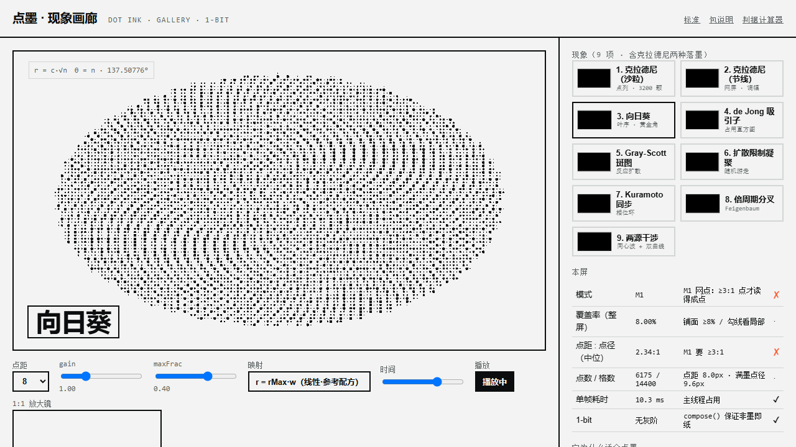
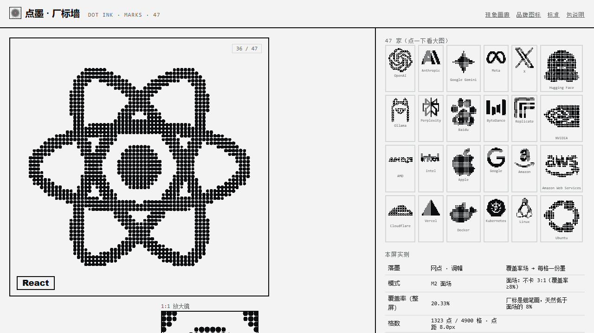
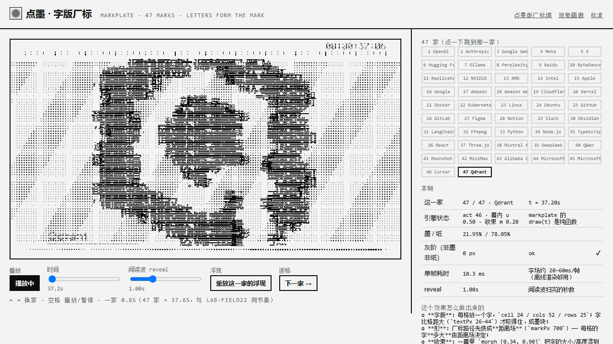
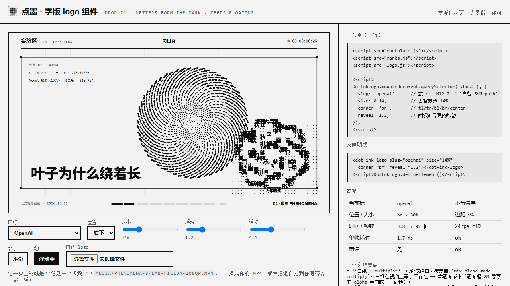

# Dot Ink · 点墨

**画面只有墨与纸两种像素；所有中间调由点的面积表达。**

调子 = 墨量，墨量 = 点面积之和。不是"加一层纹理"，是一套**成像方式**：
1-bit 二值、可逐帧确定性渲染、断网双击就能播。


> **示例 A · 参考配方**（从实验区里程碑**直接取，逐字节未改**）：
> **《公式就是画面》自然八拍** —— 40.8 s · 1920×1080 · 30fps · 无声 · 1224 帧
>
> 成片 [`media/phenomena-8/lab-field4-1080p.mp4`](media/phenomena-8/lab-field4-1080p.mp4) ·
> 八拍接触印样 [`contact-sheet.png`](media/phenomena-8/contact-sheet.png) ·
> 1:1 静帧 [`still-01…08`](media/phenomena-8) ·
> **出处与参数** [`SOURCE.md`](media/phenomena-8/SOURCE.md)
>
> 八拍：克拉德尼（**沙粒版**）· 向日葵 · de Jong · Gray-Scott · DLA · Kuramoto · 倍周期分叉 · 两源干涉
>
> **示例 B · 标准自检片**（本包渲染，用来**量判据**，不是拿来看的）：
> [`media/1010-dotink-demo-1080p.mp4`](media/1010-dotink-demo-1080p.mp4) —— 61.0 s，判据幕 + 现象幕；
> 同一批公式，**表现力明显不如示例 A** —— 差在哪、怎么补，见下节「同一批公式，差在哪」。
>
> *(Dot Ink: a 1-bit imaging standard — paper and ink only, tone expressed by dot area.
> `r = rMax·√w` so ink area is proportional to tone. See [`STANDARD.md`](STANDARD.md).)*

---

## 画廊 · 现象画廊（**视觉产品**）



> **双击 [`gallery.html`](gallery.html) 就开。** 这不是规范页，是**拿规范做出来的东西**：
> 九项现象**现场渲染**（8px 真圆盘 · 每屏一句大字标题 · 公式与来源在场），可以点、可以调、可以量。

| 能做什么 | 说明 |
|---|---|
| 九项现象 | 克拉德尼（**沙粒** / 节线 两种落墨）· 向日葵 · de Jong · Gray-Scott · DLA · Kuramoto · 倍周期分叉 · 两源干涉 |
| 现场调参 | 点距 6/8/10/12/16 · `gain` · `maxFrac` · **映射 A/B（线性 ↔ √，见 [`STANDARD.md`](STANDARD.md) §3）** · 时间轴 · 播放/暂停 |
| 实时判据 | **模式（M1 网点 / M2 面场 / M3 线刻）** · 覆盖率 · 点距:点径 · 点数/格数 · 单帧耗时 · 1-bit |
| 1:1 放大镜 | 设备像素 1:1 —— 标准的自查表要求"细节必须看 1:1" |
| 离线 | 零外部请求；同一 `t` 两次逐像素一致 |

**实测**（浏览器里量的）：九项**全部 0 灰阶像素**（1-bit 成立）· 单帧 **9–11 ms**（60fps 有余）·
无页面错误；覆盖率随现象落在 0.5%（沙粒：墨集中在节线）～27%（Kuramoto 锁相畴）之间 ——
所以判据按模式分开报，不拿 M1 的 3:1 去卡 M2 的面场。

> 它同时是 §14 参考配方的**产品形态**：点距 8px（160×90 = 14,400 格）、真圆盘、母题占满、
> 大字标题、逐现象手调 —— 那些"要补的六件事"在这里是可点可看的。

---

## 厂标墙 · 47 家（**第二件产品**）



> 双击 [`marks.html`](marks.html) 就开：47 家厂标（OpenAI · Anthropic · GitHub · Python · React …）
> **全部用点墨画**，两种落墨随时切。

| 落墨 | 做法 | 什么时候用 |
|---|---|---|
| **网点（调幅）** | 厂标 → 覆盖率场（`fields.fromImageData`：先二值化再算每格深色占比）→ 每格一份墨；场自带 gamma(0.45)，所以半径走**线性**（§3 配对规则） | 要"印刷感" |
| **实墨（1-bit 剪影）** | 路径按 **50% 阈值**切硬像素、零反锯齿 | 要"识别"；小尺寸反而更清楚 |

- 大图 8px 点距（70×70 格）+ **47 格墙** + `← →` 换家 + 空格播放（**0.8s/家 → 一遍 47 家 = 37.6s**，与实验区 `lab-field22` 同节奏）+ 1:1 放大镜
- **实测**：47 家**全部 0 灰阶**；覆盖率 20–38%（厂标是细笔画，落在 M2 面场）
- **版权口径**：路径数据来自 [simple-icons](https://github.com/simple-icons/simple-icons)（**CC0 1.0**），商标归各家、本包用于**指称** —— 详见 [`NOTICE.md`](NOTICE.md)
- 数据生成：[`tools/make-marks.mjs`](tools/make-marks.mjs)（从主库 `modules/markplate/icons.js` 只抽 key/title/d）

> 这一页还**逼出了包内核的一个静默 bug** 并修掉：`field` 直接传 `Float32Array` 时，
> 旧的检测写法把数组判成布尔 `true` → 场被吞、一帧 0 个点、**不报错**（厂标墙 47 格全空才暴露）。
> 详见 [`STANDARD.md`](STANDARD.md) §15。

## 字版厂标 · 47 家（**移植自主库 markplate**）



> 双击 [`marks-type.html`](marks-type.html) 就开：**厂标是用「字」拼出来的** —— 每格一个字，
> 字的大小按厂标的距离场走；**「阅读波」(`reveal`) 扫过时，字逐格浮现**。

- 引擎 [`markplate.js`](markplate.js) 是**从主库 `modules/markplate/markplate.js` 逐字节移植**的
  （正文 sha256 与上游一致，只在最上面加了出处头；重跑 [`tools/vendor-markplate.mjs`](tools/vendor-markplate.mjs) 可再取）
- 配置**照抄实验区 `lab-field22`《四十七家厂标》**：47 家 · `actSeconds 0.8`（一家 0.8s → 一遍 **37.6s**）· `zoom [0.98, 1.12]`
- 页面能调：**阅读波 `reveal`**（热改 `mp.opts.reveal`，0.15–3.0s）· 时间轴 · 47 格跳转 · `← →` · 空格
- **实测**：47 家全部 **0 灰阶**；墨 5.7–22%；单帧 10–45 ms（首帧含距离场烘焙 82 ms）
- 同一批厂标的**点墨版**（网点 / 1-bit 剪影）在 [`marks.html`](marks.html) —— 两条路做同一件事：**用点** 还是 **用字**

**这个效果怎么做出来的（五步）**：

| 步 | 做什么 | 参数 |
|---|---|---|
| ① **字版** | 每格放一个字 | `cell 24 · cols 52 · rows 25`；**字要比格距大**（`textPx 26–44`）才咬得住、成墨块 |
| ② **形** | 厂标路径烘成**距离场** | `markPx 700`（分辨率）· `markSize`（标在设计空间多大，**两者必须能分开**） |
| ③ **收束** | 一幕里把字的大小/高度混到标上 → **字自己拼成标** | `morph [0.34, 0.90]`（幕内进度） |
| ④ **浮现** | `reveal` = **阅读波扫完的秒数**：波扫到哪一格，哪一格的**格子值才翻一次**（所以自带"慢"，不闪） | `reveal 1.0s`（本页可热调） |
| ⑤ **动** | 只有 `ripple`（格子值翻转）+ `zoom`（推镜）—— **不能把一张静态图挪一挪** | `ripple {amp 13, len .34, speed 4.4}` · `zoom [0.98, 1.12]` |

> 下层还叠了「名字（实墨点阵）+ 尺与读数」两层，`caption: false` / `hud: false` 可整层关掉（做目录小样时用）。

## 字版 logo 组件 · 即插即用（**挂到任意视频上**）



> **三行引脚本 + 一次 `mount`**，就能把「**字拼成的标 + 阅读波浮现 + 字不断浮动**」挂到**任意视频 / 网页**上。
> [`logo-demo.html`](logo-demo.html) 是证明页 —— 它挂的就是一个普通 mp4（换成你自己的就行）。

```html
<script src="markplate.js"></script><script src="marks.js"></script><script src="logo.js"></script>
<script>
DotInkLogo.mount(document.querySelector('.host'), {
  slug: 'openai',   // 内置 47 家；或 d:'M12 2 …'（自备 SVG path）/ svg-src="my.svg"（自备文件）
  size: 0.14,       // 占容器宽 14%
  corner: 'br',     // tl / tr / bl / br / center
  reveal: 1.2,      // 阅读波浮现的秒数
});
</script>
```

或声明式：`<dot-ink-logo slug="openai" size="14%" corner="br" reveal="1.2">` + `DotInkLogo.defineElement()`。

| 能调 | 说明 |
|---|---|
| `slug` · `d` · `svg-src` | 内置 47 家 · 自备 SVG path · 自备 `.svg`（多段 `<path>` 自动合并） |
| `size` · `corner` · `margin` | 占容器宽的比例 · 九宫位置 · 边距（也按容器宽算） |
| `reveal` · `rippleSpeed` · `rippleAmp` | 浮现快慢 · **浮动快慢** · 浮动幅度 |
| `caption` · `hud` | 名字（实墨点阵）· 尺 / 进度 / 时间码 |
| `fps` · `dpr` · `smooth` · `blend` · `paused` | 重绘上限 · 像素密度 · 平滑缩放 · 混合模式 · 起手暂停 |
| API | `set` · `pause` · `resume` · `toggle` · `seek` · `layout` · `info` · `destroy` |

**实测**（挂在 1920×1080 视频上）：覆盖层单帧 **1.9–3.7 ms**（24 fps 上限下 5 秒 118 帧）·
重挂后画布数**始终 1**（旧实例会销毁）· 暂停后帧数冻结 ✓ · 无错误。

**四个实现要点**（都踩过）：

1. **白纸 + `multiply`**：纸设成纯白、覆盖层 `mix-blend-mode: multiply` —— 白纸在视频上等于不存在，
   **零逐帧成本**（逐帧抠 2M 像素的 alpha 会白吃十几毫秒）；
2. 引擎 `markplate` **要求 `marks ≥ 2`**（它靠"两个标互融"做过渡）→ 单标就**传同一个标两次**；
3. 覆盖层自带 rAF 循环：**dt 夹到 `[0, 0.1]` + try/catch** —— 首帧时间戳可能早于 `performance.now()`（负）、
   切页回来是大跳；一帧抛错若发生在 `requestAnimationFrame` 之前，播放会**静默死掉**；
4. **裁剪框是"量"出来的，不是"算"出来的**：标外的格子**也会落墨**（引擎给它们画 1–2px 小点），
   所以"有墨范围"是**整个字版**（实测 **1227×604**）；而标本身又比 `markSize·z` 大一圈
   （**字形比格距大、会溢出格子**）→ 按公式算的框会把标**切掉一圈**（第一版就是这样）。
   现在的做法：渲染一帧（等阅读波扫完）→ **按格算墨密度**（字格 8–40% vs 背景点格 0.3–1.5%，
   差一个数量级，能干净分开）→ 得到"字"的真实范围（实测 640×591）→ 加余量 + 漂移余量 →
   **装不下就自动调小 `markSize` 重建**（最多 4 次，实测从 640 收到 576）；
   覆盖层画布**按裁剪框的长宽比**（不是正方形）→ 既不拉伸也不切边。
   > 中途试过 3×3 腐蚀：**分不开** —— 汉字的笔画也只有 2–3px 粗，和背景点一样粗；
   > 那次 `markSize` 被一路缩到 275、最后退回整幅，徽标里塞进了整个字版。

> **下一步（已验证、未实现）**：同一套素材还能走 **ffmpeg 后处理**把标烧进**任意 mp4**
> （实测 61 s / 1080p 只花 **6.8 s**；纸底可用 `colorkey=0xF2F3F2` 一键抠掉，**6.6 s**）。

---

## 同一批公式，差在哪（实测对照）

两个示例用的是**同一批公式**（`lab/PHENOMENA.md` 01–08）。差距不在公式，在这六个可量/可改的数：

| 项 | **示例 A**（lab-field4 · 参考配方） | **示例 B**（本包自检片） |
|---|---|---|
| **点距** | **8 px**（08 拍 6 px）→ 160×90 = **14,400 格** | 16 px → 80×45 = **3,600 格**（**1/4**） |
| **点径** | **真圆盘** 0..3.2 px（`maxFrac 0.40`） | typefield 的 `●` **字形**缩放（不是圆盘） |
| 墨量（区域） | 2.95 %（07）– **15.21 %**（04） | 2.05 % – 8.64 % |
| **母题尺度** | 母题**占满画面**（向日葵盘 ≈ 画幅高；Kuramoto 是大相位环；分叉树横贯） | 母题偏小（塞进通用网格） |
| **构图** | 每屏一句**大字标题** + 公式 + 来源 | 左下 12 px 标签卡 |
| 覆盖 | 画面**无 DOM** | 标签卡压住画面一角 |
| 手调 | **逐现象**：01 用 3200 颗沙沿 −∇\|φ\| 迁移；06 打回仪表盘版重做；08 用 6 px 让条纹可分辨 | 场库通用实现，未按"画面"调 |

**要补的六件事**（按性价比排）：

1. **点距降到 8 px**（细条纹 6 px）—— 格数翻四倍，母题才**解**得出来；
2. **走解析圆盘**（`dotink.js` 的 DISC 路径），**不要**用字形当点 —— 字形在小尺寸是阶梯、在大尺寸是字；
3. **先定母题尺寸，再定网格**：让母题占满画面，而不是"把场塞进网格"；
4. **每屏一句大字标题**（18–40 px 级），公式与来源放角上；
5. **逐现象手调**，尤其是"兑现字幕"的那一步（01 的字幕写着"沙自己走到该在的地方"，就必须真的让沙走过去）；
6. **画面区域不压 DOM**：要放字就用画布上的实墨层，别用卡片盖住画面。

> 这六条已写进 [`STANDARD.md`](STANDARD.md) §14「参考配方」。示例 A 的参数与出处见
> [`media/phenomena-8/SOURCE.md`](media/phenomena-8/SOURCE.md)（含重建命令与 SHA256 清单）。

---

## 这一页是什么

| 文件 | 作用 |
|---|---|
| [`STANDARD.md`](STANDARD.md) | **判据唯一真相**：令牌 / 三个几何量 / 面积映射 / 两种模式 / 墨量净空 / 动 / 禁令 / 自查表（每条判据带实测出处与状态）；§13 是"与 typefield 的分工" |
| [`dotink.js`](dotink.js) | 参考实现（零依赖，经典脚本）。渲染、**场的构造器**（干涉/噪声/渐变/距离场/真图/1-bit 位图）、判据自检、独立短片宿主 |
| [`pheno.js`](pheno.js) | **自然现象场库**：`chladni / sunflower / deJong / grayScott / dla / kuramoto / bifurcation / interference`（八个都是 `(cols, rows, opts) → (i,x,y,t) → 0..1`） |
| [`preview.html`](preview.html) | **判据计算器与实验台**：8 条判据实时算、A/B 对照（√ vs 线性）、**1:1 放大镜** |
| [`gallery.html`](gallery.html) | **现象画廊（视觉产品）**：九项现象现场渲染 + 实时判据（M1/M2/M3 分开报）+ 映射 A/B + 1:1 放大镜 |
| [`marks.html`](marks.html) · [`marks.js`](marks.js) | **厂标墙（第二件产品）**：47 家厂标用点墨画（网点 / 实墨两种落墨）+ 47 格墙 + 自动翻页 |
| [`NOTICE.md`](NOTICE.md) | **第三方数据与出处**（厂标 CC0 与商标口径 / 现象公式出处 / 参考配方成片 / 自检片） |
| [`icon.svg`](icon.svg) · [`icon-*.png`](icon-512.png) · [`icon.html`](icon.html) | **品牌图标**：矢量源 / 各尺寸位图（**0 灰阶**）/ 图标工坊（任意尺寸导出 + 1-bit 自检） |
| [`tools/make-icon.mjs`](tools/make-icon.mjs) | 图标生成器（零依赖；几何即 §3/§4 的一次应用） |
| [`SKILL.md`](SKILL.md) | 给 AI 会话用的入口（什么时候用、八条判据、四条最容易踩的） |
| [`media/phenomena-8/`](media/phenomena-8) | **示例 A · 参考配方**：《公式就是画面》自然八拍（lab-field4）—— 成片 / 接触印样 / 八张 1:1 静帧 / SHA256 清单 / [`SOURCE.md`](media/phenomena-8/SOURCE.md)，**逐字节取自里程碑** |
| [`media/`](media) | 示例 B 自检片（`1010-dotink-demo`）与出图 |
| [`demo/index.html`](demo/index.html) | 自包含独立短片页（双击即播，不依赖线框引擎） |
| [`LICENSE`](LICENSE) | MIT |

---

## 品牌图标


**这个图标就是本标准的一次应用**（不是"另画一张图"）：15×15 网点 · 点距 = 画幅的 1/15 ·
中心盘 `v = clamp01((1 − (d/R)²)·1.6)` · `r = rMax·√v`（**面积映射**，§3 —— 场是物理量原样就配 √）·
`maxFrac 0.406 ≤ 0.5` ✓ · 一颗 **accent 点**（`#FF4B1F`）落在正中心：那是"点"的位置。

| 文件 | 用途 |
|---|---|
| [`icon.svg`](icon.svg) | 矢量源（由 [`tools/make-icon.mjs`](tools/make-icon.mjs) 生成）；网页 favicon 用它（本包三个页面都挂了） |
| [`icon-512.png`](icon-512.png) · [`icon-192.png`](icon-192.png) · [`icon-64.png`](icon-64.png) · [`icon-32.png`](icon-32.png) | 仓库头像 / 应用图标 / favicon —— **全部 0 灰阶**（墨 + 纸 + 一颗 accent = 100%） |
| [`icon.html`](icon.html) | **图标工坊**：任意尺寸现场渲染 · 导出 PNG · 1-bit 自检 · 16/32/64/192 并排看"读不读得清" |

```powershell
node tools/make-icon.mjs            # 重生成 icon.svg（改 PITCH / N / R / RMAX 后重跑）
node tools/make-icon.mjs --print    # 只打印几何与判据
# PNG 导出：开 icon.html → 选尺寸 → 导出 PNG（画布 toDataURL，1:1 不缩放）
```

> ⚠ 图标是**网屏**，缩下去点会并拢：覆盖率 512px **31.8%** → 192px 32.7% → 64px 48.4% → 32px **74.7%**。
> 所以 favicon 用 64px 那档；16px 时它读成"纸上一块墨" —— 这是半调的本性，不是 bug。

---

## 三十秒上手

```html
<canvas id="cv" style="width:560px;height:315px"></canvas>
<script src="dotink.js"></script>   <!-- 经典脚本，不是 ESM：file:// 下 import 会被 CORS 拦死 -->
<script>
const inst = DotInk.create({
  canvas: document.getElementById('cv'),
  cssW: 560, cssH: 315, scale: 1.5,      // backing = 840×473（×1.5 是真渲染，不是放大）
  cell: 12,                              // 点距（px）
  field: DotInk.fields.interferenceFn(46, 26, { k: .55, w: .22, speed: 1.3 }),
  gain: 1, duration: 21, shutter: 0,
});
inst.draw(3.5);      // 纯函数：同一个 t 画两次逐像素一致
inst.judge();        // 八条判据一次报全（别自己心算）
</script>
```

**独立短片**（`DotInk.host` 自带宿主契约，**两套渲染器**都能直接渲）：

```html
<div id="stage"></div>
<script src="dotink.js"></script>
<script>
  DotInk.host({ duration: 21, cell: 12, field: DotInk.fields.interferenceFn(106, 60, { k: .5, w: .2 }) });
  // 打开加 ?play 才走墙钟播放；不加就是定格（渲染路径禁自动播）
</script>
```

> 契约差异在 `host()` 里**一处**抹平（实测踩过）：
> · **B 线 `render.mjs`**：探测 `wireframeMotion`（只判存在）、要求 `__ready` 是**函数**、并读
>   `__meta.scenes`（不给会 `TypeError: … reading 'length'`）；
> · **onetake `render.py`**：`await window.__ready` —— 要的是 **thenable**。
>
> `host()` 把 `__ready` 做成"**函数 + thenable**"，并补最小宿主位与单幕 `scenes`，两边都认。
> ⚠ 宿主页**渲染时不许留 DOM 覆盖层**（提示行/角标是反锯齿文字，会被拍进帧，1-bit 破功）——
> 按 `?render` 藏掉，见 [`demo/index.html`](demo/index.html)。

---

## 参数

| 参数 | 默认 | 说明 |
|---|---|---|
| `canvas` | — | 必填（或交给 `DotInk.host` 建） |
| `cssW` `cssH` `scale` | 1280 / 720 / 1.5 | 画布契约（×1.5 → 真 1920×1080） |
| `ink` `paper` | `[12,13,14]` / `[242,243,242]` | **就是** `#0C0D0E` / `#F2F3F2`（与 wireframe 令牌逐位相同） |
| `cell` | 12 | 点距（px） |
| `cols` `rows` | 由 cell 推 | 显式给则按它算（`cell` 变成约值） |
| `maxFrac` | 0.48 | 满墨半径 = `maxFrac·cell`；**上限 0.5**（点径 = 点距 → 相切） |
| `areaMap` | `true` | ★ `r = rMax·√w`（面积映射）。`false` = 线性 `r = rMax·w`，**只作 A/B 对照** |
| `gain` `gamma` `floor` | 1 / 1 / 0.035 | `w = min(1, v·gain)`；`v = field^gamma`；`v·gain < floor` 当纸 |
| `field` | — | `(i, cx, cy, t) => 0..1`，或 `Float32Array` |
| `shutter` | 1/28 | 运动模糊（两帧叠）。0 = 关 |
| `hud` `hudC` `caption` | true / … / null | 自绘尺与读数、字幕。**都算装饰墨**（见净空） |
| `regions` | null | 分区的**格坐标** `{info:[…], deco:[…]}` → `measure()` 给出装饰:信息 |

**场的构造器**：`interferenceFn`（活的干涉）、`noise` + `scrollFn`（噪声整格滚动）、`ramp`、
`sdf`（距离场）、`fromImageData`（真图 → 覆盖率场，先二值化**再**算每格深色占比，绝不做面积平均）、
`bits`（1-bit 行程编码 → 场）。

返回：`{ draw(t), judge(t), measure(), reset(), cols, rows, cell, rMax, duration }`。

---

## 八条判据（细节、出处与状态见 [`STANDARD.md`](STANDARD.md)）

| # | 判据 | 门限 | 实测固化？ |
|---|---|---|---|
| 1 | **面积映射** `r = rMax·√w` | 必须（线性让中间调偏亮） | 是 |
| 2 | 点径 ≤ 点距 | `maxFrac ≤ 0.5` | 是 |
| 3 | M1 网点：点距 : 点径（中位） | **≥ 3 : 1** | 是（12.00:4.00 ✓ / 2.18:1 ✗） |
| 4 | M2 面场：**区域**覆盖率 | **≥ 8%**（地板 2%，天花板 55%） | 是（9.80% ✓ / 1.4% 看不见 / 52–64% 糊墙） |
| 5 | 净空：装饰墨 : 信息墨 | **≤ 1 : 1**（目标 ≤ 0.33 : 1） | 硬上限是（反例实测 1.65 : 1 ✗） |
| 6 | 归一化活动率 | ≥ 3%/帧（**镜头不动时格子值必须在翻**） | 门限待标定 |
| 7 | 1-bit | 无灰阶；**字是实墨，不过网屏** | 是 |
| 8 | 签字方式 | 数值只用来定位，**必须打开 1:1 看一眼** | 是 |

> ⚠ 量的是**区域覆盖率**，不是整帧墨量——整帧总墨量会把"一块看不见的纹理"算成"在渲染"。

---

## 示例片在验什么

**现象八幕**（自然现象系列，一现象一屏；公式与来源见主库 `lab/PHENOMENA.md` 01–08）：

| 幕 | 现象 | 一句话公式 | 来源 |
|---|---|---|---|
| 1 | 克拉德尼图形 | `φ = cos(mπu)cos(nπv) + α·cos(nπu)cos(mπv)`，节线即沙线 | Chladni 1787 |
| 2 | 向日葵 | `r = c√n`、`θ = n · 137.50776°` | Vogel 1979 |
| 3 | de Jong 吸引子 | `x' = sin(a·y) − cos(b·x)`、`y' = sin(c·x) − cos(d·y)` | de Jong / Bourke |
| 4 | Gray-Scott 反应扩散 | `∂u/∂t = Du∇²u − uv² + F(1−u)`、`∂v/∂t = Dv∇²v + uv² − (F+k)v` | Pearson 1993 |
| 5 | 扩散限制凝聚 | 随机行走的粒子碰到团簇就粘住 | Witten & Sander 1981 |
| 6 | Kuramoto 同步 | `dθᵢ/dt = ωᵢ + (K/N)·Σ sin(θⱼ − θᵢ)` | Kuramoto 1975 |
| 7 | 倍周期分叉 | `xₙ₊₁ = r·xₙ·(1−xₙ)` | Feigenbaum 1978 |
| 8 | 两源干涉 | `I ∝ cos(k·d₁) + cos(k·d₂)` | — |

**判据三幕**（把标准量给人看）：

| 幕 | 验的判据 | 做法 |
|---|---|---|
| 0 | 点距 : 点径 ≥ 3:1 | 同一个场，`gain 1`（点读得成点）vs `gain 6`（糊成一片） |
| 9 | 面积映射 | 同一张场，`r = rMax·√w` vs 线性 `r = rMax·w`（面积 ∝ w²，中间调偏亮） |
| 10 | 覆盖率区间 | 同一张场三种 gain：1.4% ✗ 看不见 / 9.8% ✓ 面成立 / 58% ✗ 糊成墙 |

**成片实测**（在渲染出来的 1080p 帧上量的，不是设计值）：

| 量 | 值 | 判据 |
|---|---|---|
| 判据幕·点墨 左（`gain 1`） | **11.23%** | M2 的 ≥8% ✓（实验室锚点 9.78%） |
| 判据幕·点墨 右（`gain 6`） | **56.01%** | 踩到 >55% 天花板 → 糊成一片 ✓ 如预期 |
| 判据幕·调子 左（`r = rMax·√w`） | 38.75% | 墨面积 ∝ 调子 |
| 判据幕·调子 右（线性） | **23.34%** | 面积 ∝ w² → 少 40% 的墨，中间调偏亮 ✓ 如预期 |
| 现象幕区域覆盖率 | 克拉德尼 2.05% · 向日葵 8.22% · deJong 8.64% · Gray-Scott 6.03% · DLA 4.77% · Kuramoto 8.05% · 分叉 2.70% · 干涉 3.66% | ⚠ **结构型现象不能拿 8% 当门槛** —— 见下 |
| 墨水层的 1-bit（渲染出的 PNG 帧） | 标签卡外只有 **131 px** 非墨非纸（占画面 0.006%） | 1-bit ✓（另有 7753 px 落在标签卡里 = DOM 文字的反锯齿，属 B 线版式，不是墨层） |

> **一条从示例里量出来的补充（已写进 [`STANDARD.md`](STANDARD.md) §4 的 M3）**：
> 克拉德尼的节线、DLA 的枝、分叉树都是**结构型**画面 —— 墨集中在结构上，
> 整区覆盖率只有 2–5%，但它们**看得见**（结构处的局部覆盖率很高）。
> 所以"M2 面场 ≥8%"只适用于**点当"面"用**的体裁；结构型要量**结构处的局部覆盖率**（阈值待标定）。

---

## 怎么复现（需要一份 B 线流水线；没有也能手渲）

```powershell
# 在主库 make-videos-kit 里（示例片是它的一期：work/1010-dotink-demo/）
node modules/wireframe/build.mjs --only 1010-dotink-demo            # content.html → film/<期号>.html
node modules/wireframe/check.mjs work/1010-dotink-demo/film/1010-dotink-demo.html   # 门禁：越界/溢出/字号
node modules/wireframe/render.mjs work/1010-dotink-demo/film/1010-dotink-demo.html  # → renders/*-1080p.mp4
```

门禁结果（生产模式）：**PASS / 退出码 0** —— 越界 0 · 溢出 0 · 字号 0（**11 幕**逐幕全绿）。

**量测**（主库自带工具，判据是数值不是感觉）：

```powershell
python lab/tools/ink-area.py --frames <帧目录> --fps 30      # 逐帧墨面积 + 相邻帧相对变化 + 硬切
python lab/tools/measure/legibility.py --frames <帧目录>      # 缩到 960/640 的墨存活率、≤2/≤4px 碎片
python lab/tools/measure/ink-budget.py --frames <帧目录>      # 尺子/墨洗带/内容/纸底 四分区墨占比
```

---

## 这套判据从哪来（不是设计稿，是实测账）

点墨标准的每一条都来自一次真实的失败或量测，出处都在主库的田野文档里：

| 判据 | 事故/量测 |
|---|---|
| 覆盖率 ≥ 8% | 1.4% 的网点"基本看不见"——**"在渲染"不等于"看得见"** |
| 点距:点径 ≥ 3:1 | 字场实测 2.18:1，点分辨不出形状 |
| 面积映射 √ | 三套点径公式互相不一致（工具链仿射 / 田野 √ / 字场固定 0.75），从没写进任何规范 |
| 净空 ≤ 1:1 | 装饰 19.4% vs 信息 11.84% = 1.65:1 ——"不是字太小，是装饰的墨比信息还重" |
| 动只能来自格子值在翻 | 漂移 ±4px、推镜每帧 1px 都翻不动格子值 |
| 归一化静止口径 | 未归一的阈值把"每帧 18% 的墨在变"误判成静止 |
| 1:1 看细节 | 用"画布有没有墨"验过两轮全过（47/47），页面肉眼是空的 |

完整的出处索引在 [`STANDARD.md`](STANDARD.md) §12。

---

## 边界

- 只管**纸 + 墨两色**的 1-bit 成像。彩色/多色网点（四色各一角度）**未纳入**。
- 抖动（Floyd–Steinberg / Bayer）是合法第三档，但会破坏"点距:点径"的整齐 → 判据改为 1:1 目视 + 覆盖率。
- `STANDARD.md` 里标 **"待标定"** 的阈值（归一化活动率门限、净空目标 0.33:1）**不要当硬门禁用**。
- 示例片**无音轨**：为了让这个包许可干净（不含任何第三方音乐），音轨请自行加。

## 许可

代码与文档 **MIT**（[`LICENSE`](LICENSE)）。标准里的数字引自同一套实验记录，属于事实引用。
