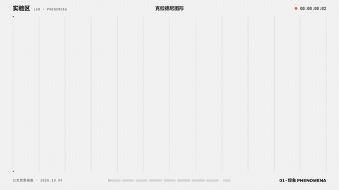
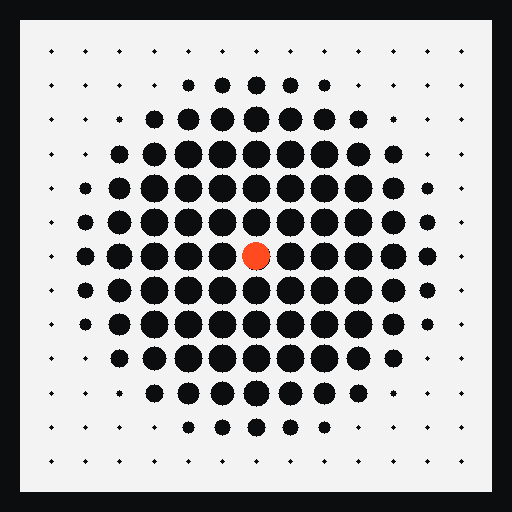

# Dot Ink · 点墨

**画面只有墨与纸两种像素；所有中间调由点的面积表达。**

调子 = 墨量，墨量 = 点面积之和。不是"加一层纹理"，是一套**成像方式**：
1-bit 二值、可逐帧确定性渲染、断网双击就能播。



> **示例 A · 参考配方**（从实验区里程碑**直接取，逐字节未改**）：
> **《公式就是画面》自然八拍** —— 40.8 s · 1920×1080 · 30fps · 无声 · 1224 帧
>
> 成片 [`lab-field4-1080p.mp4`](https://github.com/liceses/dotink/releases)（**Release 附件**，仓内只留 GIF 与 1:1 静帧） ·
> 八拍接触印样 [`contact-sheet.png`](media/phenomena-8/contact-sheet.png) ·
> 1:1 静帧 [`still-01…08`](media/phenomena-8) ·
> **出处与参数** [`SOURCE.md`](media/phenomena-8/SOURCE.md)
>
> 八拍：克拉德尼（**沙粒版**）· 向日葵 · de Jong · Gray-Scott · DLA · Kuramoto · 倍周期分叉 · 两源干涉
>
> **示例 B · 标准自检片**（本包渲染，用来**量判据**，不是拿来看的）：
> [`1010-dotink-demo-1080p.mp4`](https://github.com/liceses/dotink/releases)（**Release 附件**） —— 61.0 s，判据幕 + 现象幕；
> 同一批公式，**表现力明显不如示例 A** —— 差在哪、怎么补，见下节「同一批公式，差在哪」。
>
> **仓库**：https://github.com/liceses/dotink · **成片（Release 附件）**：https://github.com/liceses/dotink/releases
>
> *(Dot Ink: a 1-bit imaging standard — paper and ink only, tone expressed by dot area.
> `r = rMax·√w` so ink area is proportional to tone. See [`STANDARD.md`](STANDARD.md).)*

---

---

## 三块内容（各自独立可读）

| 块 | 是什么 | 从哪开始 |
|---|---|---|
| **① 规范** | 判据唯一真相 + 参考实现 + 判据计算器 | [`STANDARD.md`](STANDARD.md) · [`docs/01-standard.md`](docs/01-standard.md) · [`preview.html`](preview.html) |
| **② 自然现象展示 + 整套代码** | 九个现象现场渲染的画廊 + 场库 + 参考配方成片与静帧 | [`docs/02-phenomena.md`](docs/02-phenomena.md) · [`gallery.html`](gallery.html) · [`pheno.js`](pheno.js) |
| **③ 字符 logo 系统** | 字版厂标（字拼成标）· 点墨版厂标墙 · 即插即用 logo 组件 | [`docs/03-marks-logo.md`](docs/03-marks-logo.md) · [`logo-demo.html`](logo-demo.html) · [`marks-type.html`](marks-type.html) |

> 三块**共用一个核心**（[`dotink.js`](dotink.js) 的全局 `DotInk`）与一份第三方口径（[`NOTICE.md`](NOTICE.md)）。
> 成片走 **Release 附件**（仓内只留 GIF 与 1:1 静帧）：本地放在 `media/_release/`（已 gitignore）。

**画面只有墨与纸两种像素；所有中间调由点的面积表达。**

调子 = 墨量，墨量 = 点面积之和。不是"加一层纹理"，是一套**成像方式**：
1-bit 二值、可逐帧确定性渲染、断网双击就能播。


> **示例 A · 参考配方**（从实验区里程碑**直接取，逐字节未改**）：
> **《公式就是画面》自然八拍** —— 40.8 s · 1920×1080 · 30fps · 无声 · 1224 帧
>
> 成片 `lab-field4-1080p.mp4`（**Release 附件**，仓内只留 GIF 与 1:1 静帧） ·
> 八拍接触印样 [`contact-sheet.png`](media/phenomena-8/contact-sheet.png) ·
> 1:1 静帧 [`still-01…08`](media/phenomena-8) ·
> **出处与参数** [`SOURCE.md`](media/phenomena-8/SOURCE.md)
>
> 八拍：克拉德尼（**沙粒版**）· 向日葵 · de Jong · Gray-Scott · DLA · Kuramoto · 倍周期分叉 · 两源干涉
>
> **示例 B · 标准自检片**（本包渲染，用来**量判据**，不是拿来看的）：
> `1010-dotink-demo-1080p.mp4`（**Release 附件**） —— 61.0 s，判据幕 + 现象幕；
> 同一批公式，**表现力明显不如示例 A** —— 差在哪、怎么补，见下节「同一批公式，差在哪」。
>
> *(Dot Ink: a 1-bit imaging standard — paper and ink only, tone expressed by dot area.
> `r = rMax·√w` so ink area is proportional to tone. See [`STANDARD.md`](STANDARD.md).)*

---

---

## 这一页是什么

| 文件 | 作用 |
|---|---|
| [`STANDARD.md`](STANDARD.md) | **判据唯一真相**：令牌 / 三个几何量 / 面积映射 / 两种模式 / 墨量净空 / 动 / 禁令 / 自查表（每条判据带实测出处与状态）；§13 是"与 typefield 的分工" |
| [`dotink.js`](dotink.js) | 参考实现（零依赖，经典脚本）。渲染、**场的构造器**（干涉/噪声/渐变/距离场/真图/1-bit 位图）、判据自检、独立短片宿主 |
| [`pheno.js`](pheno.js) | **自然现象场库**：`chladni / sunflower / deJong / grayScott / dla / kuramoto / bifurcation / interference`（八个都是 `(cols, rows, opts) → (i,x,y,t) → 0..1`） |
| [`preview.html`](preview.html) | **判据计算器与实验台**：8 条判据实时算、A/B 对照（√ vs 线性）、**1:1 放大镜** |
| [`gallery.html`](gallery.html) | **现象画廊（视觉产品）**：九项现象现场渲染 + 实时判据（M1/M2/M3 分开报）+ 映射 A/B + 1:1 放大镜 |
| [`hero.html`](hero.html) | **全屏 hero 示例（把点墨当网站视觉重心）**：自适应 `scale`（DPR + 像素预算）· 后台暂停 · `reduced-motion` 定格 · 实时判据读数；正文留白是**把场压下去**做的（§5 净空），不是盖白 |
| [`marks.html`](marks.html) · [`marks.js`](marks.js) | **厂标墙（点墨版）**：47 家厂标用点墨画（网点 / 实墨两种落墨）+ 47 格墙 + 自动翻页 |
| [`marks-type.html`](marks-type.html) · [`markplate.js`](markplate.js) | **字版厂标**：厂标用**字**拼出来（每格一个字，字的大小按距离场走）+「阅读波」`reveal` **逐格浮现** —— 47 家 · 0.8s/家 · 一遍 37.6s；引擎逐字节移植自主库 `modules/markplate`（正文 sha256 与上游一致，`tools/vendor-markplate.mjs` 可复现） |
| [`NOTICE.md`](NOTICE.md) | **第三方数据与出处**（厂标 CC0 与商标口径 / 现象公式出处 / 参考配方成片 / 自检片） |
| [`icon.svg`](icon.svg) · [`icon-*.png`](icon-512.png) · [`icon.html`](icon.html) | **品牌图标**：矢量源 / 各尺寸位图（**0 灰阶**）/ 图标工坊（任意尺寸导出 + 1-bit 自检） |
| [`tools/make-icon.mjs`](tools/make-icon.mjs) | 图标生成器（零依赖；几何即 §3/§4 的一次应用） |
| [`SKILL.md`](SKILL.md) | 给 AI 会话用的入口（什么时候用、八条判据、四条最容易踩的） |
| [`media/phenomena-8/`](media/phenomena-8) | **示例 A · 参考配方**：《公式就是画面》自然八拍（lab-field4）—— 成片 / 接触印样 / 八张 1:1 静帧 / SHA256 清单 / [`SOURCE.md`](media/phenomena-8/SOURCE.md)，**逐字节取自里程碑** |
| [`media/`](media) | 示例 B 自检片（`1010-dotink-demo`）与出图 |
| [`demo/index.html`](demo/index.html) | 自包含独立短片页（双击即播，不依赖线框引擎） |
| [`LICENSE`](LICENSE) | MIT |

---

---

## 品牌图标



**这个图标就是本标准的一次应用**（不是"另画一张图"）：15×15 网点 · 点距 = 画幅的 1/15 ·
中心盘 `v = clamp01((1 − (d/R)²)·1.6)` · `r = rMax·√v`（**面积映射**，§3 —— 场是物理量原样就配 √）·
`maxFrac 0.406 ≤ 0.5` ✓ · 一颗 **accent 点**（`#FF4B1F`）落在正中心：那是"点"的位置。

| 文件 | 用途 |
|---|---|
| [`icon.svg`](icon.svg) | 矢量源（由 [`tools/make-icon.mjs`](tools/make-icon.mjs) 生成）；网页 favicon 用它（本包三个页面都挂了） |
| [`icon-512.png`](icon-512.png) · [`icon-192.png`](icon-192.png) · [`icon-64.png`](icon-64.png) · [`icon-32.png`](icon-32.png) | 仓库头像 / 应用图标 / favicon —— **全部 0 灰阶**（墨 + 纸 + 一颗 accent = 100%） |
| [`icon.html`](icon.html) | **图标工坊**：任意尺寸现场渲染 · 导出 PNG · 1-bit 自检 · 16/32/64/192 并排看"读不读得清" |

```powershell
node tools/make-icon.mjs            # 重生成 icon.svg（改 PITCH / N / R / RMAX 后重跑）
node tools/make-icon.mjs --print    # 只打印几何与判据
# PNG 导出：开 icon.html → 选尺寸 → 导出 PNG（画布 toDataURL，1:1 不缩放）
```

> ⚠ 图标是**网屏**，缩下去点会并拢：覆盖率 512px **31.8%** → 192px 32.7% → 64px 48.4% → 32px **74.7%**。
> 所以 favicon 用 64px 那档；16px 时它读成"纸上一块墨" —— 这是半调的本性，不是 bug。

---

---

## 三十秒上手

```html
<canvas id="cv" style="width:560px;height:315px;image-rendering:pixelated"></canvas>
<script src="dotink.js"></script>   <!-- 经典脚本，不是 ESM：file:// 下 import 会被 CORS 拦死 -->
<script>
const COLS = 47, ROWS = 26;                     // = round(cssW/cell) / round(cssH/cell)
const inst = DotInk.create({
  canvas: document.getElementById('cv'),
  cssW: 560, cssH: 315,
  scale: Math.min(2, devicePixelRatio),         // ★ 见下：**不要**写死 1.5
  cols: COLS, rows: ROWS, cell: 12,             // 点距（px）
  field: DotInk.fields.interferenceFn(COLS, ROWS, { k: .55, w: .22, speed: 1.3 }),
  gain: 1, duration: 21, shutter: 0,
});
inst.draw(3.5);      // 纯函数：同一个 t 画两次逐像素一致
inst.judge();        // 逐条读数：pass 按模式算，M1/M2 互斥 → 结构型传 {mode:'M3'}（见 STANDARD §4）
</script>
```

> **两件 `dotink.js` 不管、必须自己管的事**（都在实测里栽过）：
> 1. **`scale` 取 `devicePixelRatio`，不要写死 1.5** —— backing 要**等于物理像素**才是 1:1。
>    实测 DPR 1.65 的机器上按 `1.5` 建：屏幕上 **24.46% 的像素既不是墨也不是纸**（252 种灰）。
> 2. **`image-rendering: pixelated`，且画布尺寸变了要重建**（`ResizeObserver` 防抖，重建约 3ms）。
>
> 完整的写法（自适应 `scale` / 后台暂停 / `reduced-motion` 定格 / 实时判据读数）见 [`hero.html`](hero.html)。

**独立短片**（`DotInk.host` 自带宿主契约，**两套渲染器**都能直接渲）：

```html
<div id="stage"></div>
<script src="dotink.js"></script>
<script>
  DotInk.host({ duration: 21, cell: 12, field: DotInk.fields.interferenceFn(106, 60, { k: .5, w: .2 }) });
  // 打开加 ?play 才走墙钟播放；不加就是定格（渲染路径禁自动播）
</script>
```

> 契约差异在 `host()` 里**一处**抹平（实测踩过）：
> · **B 线 `render.mjs`**：探测 `wireframeMotion`（只判存在）、要求 `__ready` 是**函数**、并读
>   `__meta.scenes`（不给会 `TypeError: … reading 'length'`）；
> · **onetake `render.py`**：`await window.__ready` —— 要的是 **thenable**。
>
> `host()` 把 `__ready` 做成"**函数 + thenable**"，并补最小宿主位与单幕 `scenes`，两边都认。
> ⚠ 宿主页**渲染时不许留 DOM 覆盖层**（提示行/角标是反锯齿文字，会被拍进帧，1-bit 破功）——
> 按 `?render` 藏掉，见 [`demo/index.html`](demo/index.html)。

---

---

## 许可

代码与文档 **MIT**（[`LICENSE`](LICENSE)）。标准里的数字引自同一套实验记录，属于事实引用。
