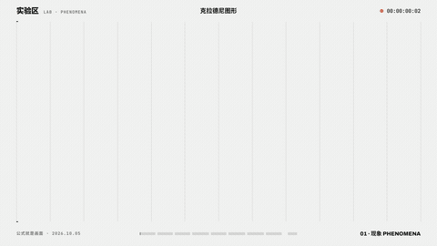
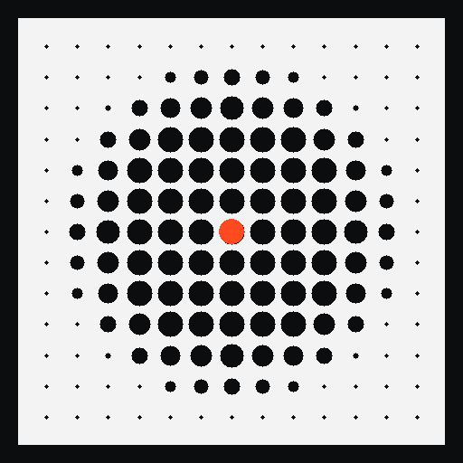

# Dot Ink · 点墨

**画面只有墨与纸两种像素；所有中间调由点的面积表达。**

调子 = 墨量，墨量 = 点面积之和。不是"加一层纹理"，是一套**成像方式**：
1-bit 二值、可逐帧确定性渲染、断网双击就能播。

**在线看**：<https://liceses.github.io/dotink/> —— 根路径就是 hero 示例；
画廊 / 判据计算器 / 厂标墙 / 图标工坊都在同一站（同一份文件，不是另做的演示站）。



> **示例 A · 参考配方**（从实验区里程碑**直接取，逐字节未改**）：
> **《公式就是画面》自然八拍** —— 40.8 s · 1920×1080 · 30fps · 无声 · 1224 帧
>
> 成片 [`lab-field4-1080p.mp4`](https://github.com/liceses/dotink/releases)（**Release 附件**，仓内只留 GIF 与 1:1 静帧） ·
> 八拍接触印样 [`contact-sheet.png`](media/phenomena-8/contact-sheet.png) ·
> 1:1 静帧 [`still-01…08`](media/phenomena-8) ·
> **出处与参数** [`SOURCE.md`](media/phenomena-8/SOURCE.md)
>
> 八拍：克拉德尼（**沙粒版**）· 向日葵 · de Jong · Gray-Scott · DLA · Kuramoto · 倍周期分叉 · 两源干涉
>
> **示例 B · 标准自检片**（本包渲染，用来**量判据**，不是拿来看的）：
> [`1010-dotink-demo-1080p.mp4`](https://github.com/liceses/dotink/releases)（**Release 附件**） —— 61.0 s，判据幕 + 现象幕；
> 同一批公式，**表现力明显不如示例 A** —— 差在哪、怎么补，见 [`docs/02-phenomena.md`](docs/02-phenomena.md) 的「同一批公式，差在哪（实测对照）」。
>
> **仓库**：https://github.com/liceses/dotink · **成片（Release 附件）**：https://github.com/liceses/dotink/releases
>
> *(Dot Ink: a 1-bit imaging standard — paper and ink only, tone expressed by dot area.
> `r = rMax·√w` so ink area is proportional to tone. See [`STANDARD.md`](STANDARD.md).)*

---

## 四块内容（各自独立可读）

| 块 | 是什么 | 从哪开始 |
|---|---|---|
| **① 规范** | 判据唯一真相 + 参考实现 + 判据计算器 | [`STANDARD.md`](STANDARD.md) · [`docs/01-standard.md`](docs/01-standard.md) · [`preview.html`](preview.html) |
| **② 自然现象展示 + 整套代码** | 九个现象现场渲染的画廊 + 场库 + 参考配方成片与静帧 | [`docs/02-phenomena.md`](docs/02-phenomena.md) · [`gallery.html`](gallery.html) · [`pheno.js`](pheno.js) |
| **③ 字符 logo 系统** | 字版厂标（字拼成标）· 点墨版厂标墙 · 即插即用 logo 组件 | [`docs/03-marks-logo.md`](docs/03-marks-logo.md) · [`logo-demo.html`](logo-demo.html) · [`marks-type.html`](marks-type.html) |
| **④ 场转场** | 两张**同网格、同编码**的场之间的替换：定向擦除 / 径向揭示 / 种子溶解 / 按墨量显影 / 字形·logo 遮罩揭示 | [`docs/04-transitions.md`](docs/04-transitions.md) · [`transition.html`](transition.html) · [`transition.js`](transition.js) |

> 四块**共用一个核心**（全局 `DotInk`；核心由 [`fields.js`](fields.js) / [`render.js`](render.js) / [`judge.js`](judge.js) / [`host.js`](host.js) 组成，[`dotink.js`](dotink.js) 只做汇总）与一份第三方口径（[`NOTICE.md`](NOTICE.md)）。
> [`transition.js`](transition.js) 与 [`press.js`](press.js) 是**可选**脚本 —— 都不依赖汇总入口，放在它之前或之后都行。
> 成片走 **Release 附件**（仓内只留 GIF 与 1:1 静帧）：本地放在 `media/_release/`（已 gitignore）。

---

## 站点地图（信息架构）

页面不是一堆平铺的链接：**分区 → 页面**，一份 [`site/nav.json`](site/nav.json) 是唯一真源，
[`tools/build-site.mjs`](tools/build-site.mjs) 把它写进每页的 `<!-- site:* -->` 标记区
（顶栏 / 副条 / 面包屑 / 页内目录 / 页脚 / meta），[`check/site.mjs`](check/site.mjs) 比对零漂移。
**手改导航会被测试打回** —— 要改导航就改 JSON，再跑构建。

| 分区 | 页面 | 一句话 |
|---|---|---|
| **规范** `spec` | [`spec.html`](spec.html) 标准与五册 · [`preview.html`](preview.html) 判据计算器 | 判据从哪来、怎么自己跑一遍验收 |
| **现象** `phenomena` | [`gallery.html`](gallery.html) 现象画廊 | 九项自然现象现场渲染 + 实时判据 |
| **字符与厂标** `marks` | [`marks-type.html`](marks-type.html) 字版厂标 · [`marks.html`](marks.html) 点墨厂标 · [`logo-demo.html`](logo-demo.html) logo 组件 · [`icon.html`](icon.html) 品牌图标 | 同一套判据一路缩到 32px |
| **场转场** `transitions` | [`transition.html`](transition.html) 场转场 | 两张同网格的场之间怎么换 |
| **套印** `press` | [`press.html`](press.html) 套印不齐 | 多版套印的失控与校准（P1–P4 另立判据） |
| *资源* | [`theme.html`](theme.html) 色彩模板 | 六套配色与三层令牌 |

导航规则（由 `check/site.mjs` 强制）：

- 顶栏 = 5 个分区 + 1 个资源，**不列单个页面**；
- 分区有多页时，顶栏该项用 `aria-current="true"`，精确的那一页由**副条**标 `aria-current="page"` —— 全页恰好一个 `page`；
- 面包屑末项是普通 `<span>`（不带 `aria-current`），所以「当前页」永远只有一个；
- 每页都有 `meta description` / `og:*` / `canonical` / `theme-color`，description 限 24–160 字；
- 页内目录由构建器给 `<h2>` 补 `id="sec-N"` 生成，**零 JS**。

> 两个刻意不登记的页面：[`demo/index.html`](demo/index.html)（"最小接入"示例，渲染时不许有 DOM 叠加层，STANDARD §7-1）
> 与 [`tools/press-reel.html`](tools/press-reel.html)（离线出片工具）。

---

## 六套配色（站点主题，可选）

**标准只有一套（`original`），站点可以换皮。** 换的是**界面令牌**与**画布的两个三元组**，
不换的是"两色像素 / 零灰阶 / 逐帧确定性"——那三条一条都不动。

| slug | 名称 | 模式 | 性质 | 观感 |
|---|---|---|---|---|
| `original` | 原件 | light | **standard** | 标准即默认（`#F2F3F2` 纸 / `#0C0D0E` 墨） |
| `night` | 夜墨 | dark | edition | 纸墨翻转，暗底上强调色更亮 |
| `newsprint` | 新闻纸 | light | edition | 暖纸深褐墨，印刷感最强 |
| `cyanotype` | 蓝晒 | light | edition | 冷蓝墨配电锈红 |
| `xerox` | 静电 | light | edition | 中性灰配电光蓝，唯一不走暖色的强调 |
| `vermilion` | 朱墨 | light | edition | 米纸朱砂 |

右上角的六个圆点就是切换器（`theme.js` 生成，选择存 `localStorage['dotink.theme']`；
没选过则跟随系统 `prefers-color-scheme`，暗色系统直接给 `night`）。打印永远回落原件。

```html
<link rel="stylesheet" href="theme.css">   <!-- 必须在 ink.css 之前 -->
<link rel="stylesheet" href="ink.css">
<script src="theme.js"></script>
```

```js
const c = DotInkTheme.canvas();                            // { ink:[r,g,b], paper:[r,g,b] }
const inst = DotInk.create({ canvas, …opts, ink: c.ink, paper: c.paper });
DotInkTheme.onChange(() => rebuild());                     // ⚠ 换套必须**重建**实例
```

> 为什么要重建：`render.js` 在 `create()` 时就把 `ink` / `paper` 收进闭包了，改 `opts` 不生效。
> 加一套：改 [`theme/palettes.json`](theme/palettes.json) → `node tools/build-theme.mjs` → `node --test check/theme.mjs`。
> 细节（三层令牌、八条对比度门禁、禁令与豁免）见 [`THEME.md`](THEME.md)。

---

## 这一页是什么

| 文件 | 作用 |
|---|---|
| [`STANDARD.md`](STANDARD.md) | **判据唯一真相**：令牌 / 三个几何量 / 面积映射 / 两种模式 / 墨量净空 / 动 / 禁令 / 自查表（每条判据带实测出处与状态）；§13 是"与 typefield 的分工" |
| [`fields.js`](fields.js) | **场构造器**（零依赖）：干涉 / 噪声 / 渐变 / 距离场 / 真图 / 1-bit 位图；静态 `Float32Array` 与 `(i,x,y,t)` 两种形态 |
| [`render.js`](render.js) | **渲染核心**：场 → 1-bit 帧（解析圆盘 · 面积映射 · 纯函数 `draw(t)` · `overlays` 钩子） |
| [`judge.js`](judge.js) | **判据**：`measure` / `judge`（M1/M2/M3 互斥门禁）· 真读画布数灰阶 |
| [`host.js`](host.js) | **独立短片宿主**：`__meta` / `__ready` / `__seek`（两套渲染器的契约差异在这里抹平） |
| [`dotink.js`](dotink.js) | **汇总入口**：装配 `DotInk.create`（渲染 + 判据）并导出；装载顺序 `fields → render → judge → host → dotink` |
| [`hud.js`](hud.js) | **可选叠加层**：尺 / 进度 / 5×7 点阵时间码 / 实墨字幕 —— 核心不认识 HUD，用 `overlays: [DotInk.hud(), …]` 显式挂上 |
| [`transition.js`](transition.js) · [`transition.html`](transition.html) | **场转场**（可选脚本，零依赖）：同网格同编码的两张场 A→B —— 定向擦除 / 径向揭示 / 种子溶解 / 按墨量显影 / 字形·logo 遮罩揭示；进度 `p` 的纯函数，端点逐字节就是 A/B，可倒放、可随机 seek；演示页带 A/B 图案、模式参数、播放/拖动、键盘、`reduced-motion`。规范见 [`docs/04-transitions.md`](docs/04-transitions.md) |
| [`press.js`](press.js) · [`press.html`](press.html) | **套印不齐**（可选脚本，零依赖）：一张画面分成 2–8 张**版**，每版仍只有「有墨/没墨」，颜色靠**减色叠印**查表得来；版间留可控的 `drift` 偏移 → 边缘漏色重影。单版 + `angle 0` + `shutter 0` 与单色层**逐字节相同**（严格超集）。规范见 [`docs/05-misregistration.md`](docs/05-misregistration.md) |
| [`pheno.js`](pheno.js) | **自然现象场库**：`chladni / sunflower / deJong / grayScott / dla / kuramoto / bifurcation / interference`（八个都是 `(cols, rows, opts) → (i,x,y,t) → 0..1`） |
| [`preview.html`](preview.html) | **判据计算器与实验台**：8 条判据实时算、A/B 对照（√ vs 线性）、**1:1 放大镜** |
| [`gallery.html`](gallery.html) | **现象画廊（视觉产品）**：九项现象现场渲染 + 实时判据（M1/M2/M3 分开报）+ 映射 A/B + 1:1 放大镜 |
| [`hero.html`](hero.html) | **全屏 hero 示例（把点墨当网站视觉重心）**：自适应 `scale`（DPR + 像素预算）· 后台暂停 · `reduced-motion` 定格 · 实时判据读数；正文留白是**把场压下去**做的（§5 净空），不是盖白 |
| [`marks.html`](marks.html) · [`marks.js`](marks.js) | **厂标墙（点墨版）**：47 家厂标用点墨画（网点 / 实墨两种落墨）+ 47 格墙 + 自动翻页 |
| [`marks-type.html`](marks-type.html) · [`markplate.js`](markplate.js) | **字版厂标**：厂标用**字**拼出来（每格一个字，字的大小按距离场走）+「阅读波」`reveal` **逐格浮现** —— 47 家 · 0.8s/家 · 一遍 37.6s；引擎逐字节移植自主库 `modules/markplate`（正文 sha256 与上游一致，`tools/vendor-markplate.mjs` 可复现） |
| [`NOTICE.md`](NOTICE.md) | **第三方数据与出处**（厂标 CC0 与商标口径 / 现象公式出处 / 参考配方成片 / 自检片） |
| [`icon.svg`](icon.svg) · [`icon-*.png`](icon-512.png) · [`icon.html`](icon.html) | **品牌图标**：矢量源 / 各尺寸位图（**0 灰阶**）/ 图标工坊（任意尺寸导出 + 1-bit 自检） |
| [`tools/make-icon.mjs`](tools/make-icon.mjs) | 图标生成器（零依赖；几何即 §3/§4 的一次应用） |
| [`SKILL.md`](SKILL.md) | 给 AI 会话用的入口（什么时候用、八条判据、四条最容易踩的） |
| [`THEME.md`](THEME.md) | **配色说明**：三层令牌、六套配色、八条对比度门禁、怎么加一套 |
| [`theme/palettes.json`](theme/palettes.json) | **配色唯一真源**：六套 × （10 个界面令牌 + 画布 ink/paper 三元组） |
| [`theme.css`](theme.css) · [`theme.js`](theme.js) | **生成件**（不许手改）：令牌表 + 切换器；`DotInkTheme.canvas()` 给画布取色，`onChange()` 在换套时重建实例 |
| [`tools/build-theme.mjs`](tools/build-theme.mjs) · [`tools/build-site.mjs`](tools/build-site.mjs) | 两个生成器：`--check` 只比对，有漂移 exit 1 |
| [`check/theme.mjs`](check/theme.mjs) · [`check/site.mjs`](check/site.mjs) | 两层验收：配色（门禁 / 零漂移 / 裸色禁令）与信息架构（标记 / 面包屑 / aria / meta / 孤儿页） |
| [`media/phenomena-8/`](media/phenomena-8) | **示例 A · 参考配方**：《公式就是画面》自然八拍（lab-field4）—— 成片 / 接触印样 / 八张 1:1 静帧 / SHA256 清单 / [`SOURCE.md`](media/phenomena-8/SOURCE.md)，**逐字节取自里程碑** |
| [`media/`](media) | 示例 B 自检片（`1010-dotink-demo`）与出图 |
| [`demo/index.html`](demo/index.html) | 自包含独立短片页（双击即播，不依赖线框引擎） |
| [`LICENSE`](LICENSE) | MIT |

---

## 品牌图标



**这个图标就是本标准的一次应用**（不是"另画一张图"）：15×15 网点 · 点距 = 画幅的 1/15 ·
中心盘 `v = clamp01((1 − (d/R)²)·1.6)` · `r = rMax·√v`（**面积映射**，§3 —— 场是物理量原样就配 √）·
`maxFrac 0.406 ≤ 0.5` ✓ · 一颗 **accent 点**（`#FF4B1F`）落在正中心：那是"点"的位置。

| 文件 | 用途 |
|---|---|
| [`icon.svg`](icon.svg) | 矢量源（由 [`tools/make-icon.mjs`](tools/make-icon.mjs) 生成）；网页 favicon 用它（本包三个页面都挂了） |
| [`icon-512.png`](icon-512.png) · [`icon-192.png`](icon-192.png) · [`icon-64.png`](icon-64.png) · [`icon-32.png`](icon-32.png) | 仓库头像 / 应用图标 / favicon —— **全部 0 灰阶**（墨 + 纸 + 一颗 accent = 100%） |
| [`icon.html`](icon.html) | **图标工坊**：任意尺寸现场渲染 · 导出 PNG · 1-bit 自检 · 16/32/64/192 并排看"读不读得清" |

```powershell
node tools/make-icon.mjs            # 重生成 icon.svg（改 PITCH / N / R / RMAX 后重跑）
node tools/make-icon.mjs --print    # 只打印几何与判据
# PNG 导出：开 icon.html → 选尺寸 → 导出 PNG（画布 toDataURL，1:1 不缩放）
```

> ⚠ 图标是**网屏**，缩下去点会并拢：覆盖率 512px **31.8%** → 192px 32.7% → 64px 48.4% → 32px **74.7%**。
> 所以 favicon 用 64px 那档；16px 时它读成"纸上一块墨" —— 这是半调的本性，不是 bug。

---

## 三十秒上手

```html
<canvas id="cv" style="width:560px;height:315px;image-rendering:pixelated"></canvas>
<script src="fields.js"></script>
<script src="render.js"></script>
<script src="judge.js"></script>
<script src="host.js"></script>
<script src="dotink.js"></script>   <!-- 汇总入口，必须最后；经典脚本不是 ESM：file:// 下 import 会被 CORS 拦死 -->
<script>
const COLS = 47, ROWS = 26;                     // = round(cssW/cell) / round(cssH/cell)
const inst = DotInk.create({
  canvas: document.getElementById('cv'),
  cssW: 560, cssH: 315,
  scale: Math.min(2, devicePixelRatio),         // ★ 见下：**不要**写死 1.5
  cols: COLS, rows: ROWS, cell: 12,             // 点距（px）
  field: DotInk.fields.interferenceFn(COLS, ROWS, { k: .55, w: .22, speed: 1.3 }),
  gain: 1, duration: 21, shutter: 0,
});
inst.draw(3.5);      // 纯函数：同一个 t 画两次逐像素一致
inst.judge();        // 逐条读数：pass 按模式算，M1/M2 互斥 → 结构型传 {mode:'M3'}（见 STANDARD §4）
</script>
```

**要 HUD / 字幕**：核心不认识它们 —— 加 `<script src="hud.js"></script>`，然后
`overlays: [DotInk.hud(), DotInk.caption({ x: 96, y: 596, px: 40, texts })]`。
两件都是 `(api, t) => void` 的叠加层，属**装饰墨**（会被 `judge()` 的净空判据计入）。

> **两件 `dotink.js` 不管、必须自己管的事**（都在实测里栽过）：
> 1. **`scale` 取 `devicePixelRatio`，不要写死 1.5** —— backing 要**等于物理像素**才是 1:1。
>    实测 DPR 1.65 的机器上按 `1.5` 建：屏幕上 **24.46% 的像素既不是墨也不是纸**（252 种灰）。
> 2. **`image-rendering: pixelated`，且画布尺寸变了要重建**（`ResizeObserver` 防抖，重建约 3ms）。
>
> 完整的写法（自适应 `scale` / 后台暂停 / `reduced-motion` 定格 / 实时判据读数）见 [`hero.html`](hero.html)。

**独立短片**（`DotInk.host` 自带宿主契约，**两套渲染器**都能直接渲）：

```html
<div id="stage"></div>
<script src="fields.js"></script>
<script src="render.js"></script>
<script src="judge.js"></script>
<script src="host.js"></script>
<script src="dotink.js"></script>
<script>
  DotInk.host({ duration: 21, cell: 12, field: DotInk.fields.interferenceFn(106, 60, { k: .5, w: .2 }) });
  // 打开加 ?play 才走墙钟播放；不加就是定格（渲染路径禁自动播）
</script>
```

> 契约差异在 `host()` 里**一处**抹平（实测踩过）：
> · **B 线 `render.mjs`**：探测 `wireframeMotion`（只判存在）、要求 `__ready` 是**函数**、并读
>   `__meta.scenes`（不给会 `TypeError: … reading 'length'`）；
> · **onetake `render.py`**：`await window.__ready` —— 要的是 **thenable**。
>
> `host()` 把 `__ready` 做成"**函数 + thenable**"，并补最小宿主位与单幕 `scenes`，两边都认。
> ⚠ 宿主页**渲染时不许留 DOM 覆盖层**（提示行/角标是反锯齿文字，会被拍进帧，1-bit 破功）——
> 按 `?render` 藏掉，见 [`demo/index.html`](demo/index.html)。

---

## 套印不齐（可选件 `press.js`）

单色层是**一张版**：有墨 / 没墨，两种像素。套印层是**N 张版**：每张版的每一格仍然只有「有墨 / 没墨」，
颜色是**叠**出来的 —— 第 k 格实际颜色 = 这个格子里哪几版落了墨，去调色板查表（减色：透过率相乘）。
版与版之间留一点可控的对不准（`drift`），边缘就漏出别的色，成为重影。

**它不替换单色层。** 单版 + `angle 0` + `shutter 0` 时，press 与 `render.js` 直画**逐字节相同**
（本机 1920×1080 = 2,073,600 px，diff **0**），所以是严格超集：旧代码不用改，换 press 只是多出「版」这一维。
注意 `angle 45` 的版与单色层那张 45° 网屏**不**等价（点阵被旋转了），实测同一帧 **315 723 / 921 600 = 34.26%** 的像素不同
（旧稿的 18.2% 是**按通道数**算的；按像素是 34–35%）。

```html
<canvas id="cv" style="width:1280px;height:720px"></canvas>

<script src="fields.js"></script>
<script src="render.js"></script>   <!-- 几何与圆盘栅格化全在这里 -->
<script src="judge.js"></script>
<script src="host.js"></script>
<script src="dotink.js"></script>   <!-- 汇总入口，必须压在所有核件之后 -->
<script src="press.js"></script>    <!-- 必须在 render.js 与 dotink.js 之后 -->

<script>
const CW = 1280, CH = 720, CELL = 8;
const COLS = CW / CELL, ROWS = CH / CELL;

/* ① 画一张源图（视频帧、设计稿、生成的图都行） */
const src = document.createElement('canvas');
src.width = CW; src.height = CH;
const sx = src.getContext('2d', { willReadFrequently: true });
sx.fillStyle = '#1b3a5c'; sx.fillRect(0, 0, CW, CH);
sx.fillStyle = '#f2e6a0'; sx.beginPath();
sx.arc(CW * .62, CH * .42, CH * .30, 0, 7); sx.fill();

/* ② 分色：RGB → C/M/Y/K 四张版，每版每格一个墨量 0..1（纯函数） */
const rgba = sx.getImageData(0, 0, CW, CH).data;
const plates = DotInk.press.separate(rgba, CW, CH, COLS, ROWS, { ucr: .55 });

/* ③ 建实例：四版都 45°（准同角度），靠 drift 把它们晃开 */
const inst = DotInk.press.create({
  canvas: document.getElementById('cv'), cssW: CW, cssH: CH,
  scale: Math.min(2, devicePixelRatio), cell: CELL, maxFrac: .40,
  areaMap: true, floor: .035, ucr: .55, tacLimit: 2.4,
  plates: plates, duration: 12,
  inks: [
    { name: 'C', rgb: [0, 174, 239], angle: 45 },
    { name: 'M', rgb: [236, 0, 140], angle: 45 },
    { name: 'Y', rgb: [255, 241, 0],  angle: 45 },
    { name: 'K', rgb: [12, 13, 14],   angle: 45 },
  ],
  drift: { amp: 5, speed: .8, seed: 3, rot: .3 },
});

inst.draw(4.0);                       // 纯函数：同一个 t 画两次逐像素一致
const m = inst.measure();             // 四条硬判据的原料都在这里
console.log(m.badPixels, m.tac, m.colors, m.paletteColors);
</script>
```

四条硬判据（**不是**单色层那八条 —— M1/M2/M3 在这里恒假，两套判据不可互套）：

| # | 判据 | 门限 | 字段 |
|---|---|---|---|
| P1 | 只落在套印格点集上 | `badPixels === 0` | `badPixels` |
| P2 | 总墨量不超限 | `tac ≤ tacLimit`（默认 2.4 = 240%；⚠ 见下） | `tac` |
| P3 | 色数不超调色板 | `colors ≤ paletteColors` | `colors / paletteColors` |
| P4 | 每版都有墨 | 每版 `cov > 0` | `plates` |

> ⚠ **四版不是 16 色。** 2^4 = 16 个掩码里，CMY 叠印（code 7）与 CMYK 叠印（code 15）用减色乘法算出来
> **都是纯黑**，所以格点集实到 **15** 色（`measure()` 的 `colors` 按 RGB 折叠统计，`collisions` 会报 `[[7,15]]`）。
> 六色（Hexachrome = CMYK + 橙 + 绿）64 掩码 → **35** 色；八色（+ 蓝 + 红）256 → **85 色**。版数上限 8。
>
> ⚠ **P2 的口径要看清楚**：`limitTac` 压的是每格**墨量 w 之和**，`measure().tac` 报的是**覆盖率之和**，两者差一条
> `coverageCurve`。所以 `maxFrac ≳ .54` 时 `tac ≤ tacLimit` 并不成立（实测 `maxFrac .56` 报 2.4034 > 2.4）；
> 而 `tacLimit ≥ N` 是空操作（四版给 4.0 = 没有限制）。想拿它当硬门禁就把 `maxFrac` 压在 ≤ .52，
> 或者用覆盖率口径（`press.html` 用 300% / 340%）。

**性能（实测，不是估算）**：1080p 背板（1280×720 CSS × scale 1.5）· cell 8 = 160×90 格 · 只算 `draw(t)` ——
1 版 **6.6–7.6 ms** ｜ **4 版 12.3–14.4 ms（≈70–80 fps）** ｜ 6 版 18.3–21.0 ｜ 8 版 22.5–23.0 ms；
1280×720 背板四版 **7.7–7.9 ms**。每加一版边际约 1.6–2.6 ms。
`measure()`（整帧 `getImageData` 读回）另加 **4.8 ms** —— **实时预览**只 `draw`，**离线导出**才量测（`draw` + `toDataURL` 约 0.02–0.03 s/帧，可以任意加版）。
**多色的瓶颈是分色不是绘制**：六色 `separateCov` sweeps 24 约 42 ms、sweeps 30 约 52 ms；`coverageCurve` 18–24 ms 且**必须缓存**。

> 同一参数在不同轮次里能差 **1.9 倍**（四版 1080p 的各轮中位见过 12.3 / 14.4 / 15.4 / 20.4 / 35.7 ms），拿它当**数量级**，不是常数。
> 这套数字只在本机成立（headless Edge / 1280×720 / 160×90 格）。换机器、换格子数都要重量；
> 完整判据、两个网角体裁（准同角度 vs 玫瑰斑）、drift 参数区间与反面清单见 [`docs/05-misregistration.md`](docs/05-misregistration.md)。

**六色（Hexachrome）要换三处**：墨组加橙 `[255,108,0]` 与绿 `[0,166,81]`、分色换成覆盖域 `separateCov`（要先量一条 `coverageCurve` 并缓存）、
`tacLimit` 抬到 4.2。四版默认体裁是**准同角度**（四版同 45°，靠 `drift` 晃开），六色**反过来**用玫瑰斑（对齐就 35 色 / 64 掩码）。

成片见 [`media/press-reel-clip.mp4`](media/press-reel-clip.mp4)（17 s / 510 帧 / 1280×720 / 7.53 MB；母版 1920×1080 qp18 = 221.15 MB，走 Release 附件），片源与导出脚本是
[`tools/press-reel.html`](tools/press-reel.html) + [`tools/press-reel.mjs`](tools/press-reel.mjs)。

### 管线：任意素材进，套印片出

上面那条片是**四段写死的样张**。这一条不是 —— 给什么视频就印什么，题材、时长、段数都由参数决定。
中间多一道**格子图集**（一格 = 一帧缩到网格粒度之后的那张图），因为分色是按格取平均的：
直接从视频解码，同一个 `t` 会出不同的帧；压成图集之后**一格 = 一个像素**，取平均只做一次，往下的每一帧仍然只是 `t` 的纯函数。

```bash
# ① 视频 → 格子图集（274×102 一格一像素，同目录落一个 .json sidecar）
node tools/press-clip.mjs --in a.mp4 --out a.png --cells 274x102 --fps 30 --dur 3

# ② 图集 → 套印片。多段必须用 | 分隔；单条可以只给路径（标签由文件名推）。末尾自动补字版
node tools/press-reel.mjs --clips "01 果物~a.png~3|02 肌肤~b.png~3" --type 3 \
     --inks hex --angles rose --sep cov --mode free \
     --out media/_release/press-pipe.mp4
```

三个 `exit 0` 却会画坏的坑（细节见 [`docs/05`](docs/05-misregistration.md) §11.3）：

| 坑 | 症状 | 现在怎么做 |
|---|---|---|
| `tile` 静默补满 | 帧数不够时用纸色补满空格，退出码还是 0 | 自己数 `showinfo`，对不上就 die |
| `format=rgb24` 放在 `scale` 之后 | 面积平均在解码器的 yuv420p 上做，格均色漂 → 边缘格翻版 | 必须放在 `scale` **之前** |
| 用命令行 DUR 截片 | 长片后半段全是重复末帧 | 取页面报的 `dur`：`Math.round(meta.dur * FPS)` |

**性能（实测）**：图集 128 帧 **395–620 ms**（中位 431）；导出六色 1080p 摊薄 **≈200–207 ms/帧**（12 s / 360 帧整片三次实测 **71.8–74.5 s**，输出**逐字节相同**），
四版 1280×720 是 **53–72 ms/帧**。素材门槛是判据：**16:9**、**有明确主体、明暗各半** —— 反例是仓里那段 854×480 抽象彩块，
压到 274×102 格之后只剩几道等高线状的弧。

不给 `--out` 时默认写 `media/_release/press-reel.mp4`（该目录不进仓）。

示例片 [`media/press-pipe-clip.mp4`](media/press-pipe-clip.mp4)（12 s / 360 帧 / 1280×720 / 5.4 MB），
图集长什么样见图 [`media/press-pipe-atlas.png`](media/press-pipe-atlas.png)，源与印的对照见 [`media/press-pipe-pair.png`](media/press-pipe-pair.png)。

---

## 许可

代码与文档 **MIT**（[`LICENSE`](LICENSE)）。标准里的数字引自同一套实验记录，属于事实引用。
