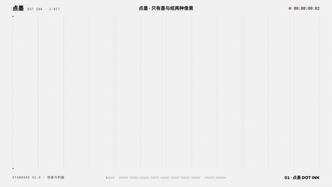

# Dot Ink · 点墨

**画面只有墨与纸两种像素；所有中间调由点的面积表达。**

调子 = 墨量，墨量 = 点面积之和。不是"加一层纹理"，是一套**成像方式**：
1-bit 二值、可逐帧确定性渲染、断网双击就能播。



> **示例片**（61.0 s · 1920×1080 · 30fps · 1830 帧 · 无音轨）：
> [`media/1010-dotink-demo-1080p.mp4`](media/1010-dotink-demo-1080p.mp4) ·
> 抽帧总表 [`media/sheet.png`](media/sheet.png) · 封面 [`media/poster.png`](media/poster.png)
>
> 内容：**自然现象八幕**（克拉德尼 / 向日葵 / de Jong / Gray-Scott / DLA / Kuramoto / 倍周期分叉 / 两源干涉）
> ＋ **判据三幕**（点距与面积映射 / 覆盖率地板）。现象幕整幅交给 `modules/typefield`
> —— 用它自己的 HUD 与相机，把 `text` 设成 `●` 就是点墨渲染器（见 [`STANDARD.md`](STANDARD.md) §13）。
>
> *(Dot Ink: a 1-bit imaging standard — paper and ink only, tone expressed by dot area.
> `r = rMax·√w` so ink area is proportional to tone. See [`STANDARD.md`](STANDARD.md).)*

---

## 这一页是什么

| 文件 | 作用 |
|---|---|
| [`STANDARD.md`](STANDARD.md) | **判据唯一真相**：令牌 / 三个几何量 / 面积映射 / 两种模式 / 墨量净空 / 动 / 禁令 / 自查表（每条判据带实测出处与状态）；§13 是"与 typefield 的分工" |
| [`dotink.js`](dotink.js) | 参考实现（零依赖，经典脚本）。渲染、**场的构造器**（干涉/噪声/渐变/距离场/真图/1-bit 位图）、判据自检、独立短片宿主 |
| [`pheno.js`](pheno.js) | **自然现象场库**：`chladni / sunflower / deJong / grayScott / dla / kuramoto / bifurcation / interference`（八个都是 `(cols, rows, opts) → (i,x,y,t) → 0..1`） |
| [`preview.html`](preview.html) | **判据计算器与实验台**：8 条判据实时算、A/B 对照（√ vs 线性）、**1:1 放大镜** |
| [`SKILL.md`](SKILL.md) | 给 AI 会话用的入口（什么时候用、八条判据、四条最容易踩的） |
| [`media/`](media) | 示例片与出图 |
| [`demo/index.html`](demo/index.html) | 自包含独立短片页（双击即播，不依赖线框引擎） |
| [`LICENSE`](LICENSE) | MIT |

---

## 三十秒上手

```html
<canvas id="cv" style="width:560px;height:315px"></canvas>
<script src="dotink.js"></script>   <!-- 经典脚本，不是 ESM：file:// 下 import 会被 CORS 拦死 -->
<script>
const inst = DotInk.create({
  canvas: document.getElementById('cv'),
  cssW: 560, cssH: 315, scale: 1.5,      // backing = 840×473（×1.5 是真渲染，不是放大）
  cell: 12,                              // 点距（px）
  field: DotInk.fields.interferenceFn(46, 26, { k: .55, w: .22, speed: 1.3 }),
  gain: 1, duration: 21, shutter: 0,
});
inst.draw(3.5);      // 纯函数：同一个 t 画两次逐像素一致
inst.judge();        // 八条判据一次报全（别自己心算）
</script>
```

**独立短片**（`DotInk.host` 自带宿主契约，**两套渲染器**都能直接渲）：

```html
<div id="stage"></div>
<script src="dotink.js"></script>
<script>
  DotInk.host({ duration: 21, cell: 12, field: DotInk.fields.interferenceFn(106, 60, { k: .5, w: .2 }) });
  // 打开加 ?play 才走墙钟播放；不加就是定格（渲染路径禁自动播）
</script>
```

> 契约差异在 `host()` 里**一处**抹平（实测踩过）：
> · **B 线 `render.mjs`**：探测 `wireframeMotion`（只判存在）、要求 `__ready` 是**函数**、并读
>   `__meta.scenes`（不给会 `TypeError: … reading 'length'`）；
> · **onetake `render.py`**：`await window.__ready` —— 要的是 **thenable**。
>
> `host()` 把 `__ready` 做成"**函数 + thenable**"，并补最小宿主位与单幕 `scenes`，两边都认。
> ⚠ 宿主页**渲染时不许留 DOM 覆盖层**（提示行/角标是反锯齿文字，会被拍进帧，1-bit 破功）——
> 按 `?render` 藏掉，见 [`demo/index.html`](demo/index.html)。

---

## 参数

| 参数 | 默认 | 说明 |
|---|---|---|
| `canvas` | — | 必填（或交给 `DotInk.host` 建） |
| `cssW` `cssH` `scale` | 1280 / 720 / 1.5 | 画布契约（×1.5 → 真 1920×1080） |
| `ink` `paper` | `[12,13,14]` / `[242,243,242]` | **就是** `#0C0D0E` / `#F2F3F2`（与 wireframe 令牌逐位相同） |
| `cell` | 12 | 点距（px） |
| `cols` `rows` | 由 cell 推 | 显式给则按它算（`cell` 变成约值） |
| `maxFrac` | 0.48 | 满墨半径 = `maxFrac·cell`；**上限 0.5**（点径 = 点距 → 相切） |
| `areaMap` | `true` | ★ `r = rMax·√w`（面积映射）。`false` = 线性 `r = rMax·w`，**只作 A/B 对照** |
| `gain` `gamma` `floor` | 1 / 1 / 0.035 | `w = min(1, v·gain)`；`v = field^gamma`；`v·gain < floor` 当纸 |
| `field` | — | `(i, cx, cy, t) => 0..1`，或 `Float32Array` |
| `shutter` | 1/28 | 运动模糊（两帧叠）。0 = 关 |
| `hud` `hudC` `caption` | true / … / null | 自绘尺与读数、字幕。**都算装饰墨**（见净空） |
| `regions` | null | 分区的**格坐标** `{info:[…], deco:[…]}` → `measure()` 给出装饰:信息 |

**场的构造器**：`interferenceFn`（活的干涉）、`noise` + `scrollFn`（噪声整格滚动）、`ramp`、
`sdf`（距离场）、`fromImageData`（真图 → 覆盖率场，先二值化**再**算每格深色占比，绝不做面积平均）、
`bits`（1-bit 行程编码 → 场）。

返回：`{ draw(t), judge(t), measure(), reset(), cols, rows, cell, rMax, duration }`。

---

## 八条判据（细节、出处与状态见 [`STANDARD.md`](STANDARD.md)）

| # | 判据 | 门限 | 实测固化？ |
|---|---|---|---|
| 1 | **面积映射** `r = rMax·√w` | 必须（线性让中间调偏亮） | 是 |
| 2 | 点径 ≤ 点距 | `maxFrac ≤ 0.5` | 是 |
| 3 | M1 网点：点距 : 点径（中位） | **≥ 3 : 1** | 是（12.00:4.00 ✓ / 2.18:1 ✗） |
| 4 | M2 面场：**区域**覆盖率 | **≥ 8%**（地板 2%，天花板 55%） | 是（9.80% ✓ / 1.4% 看不见 / 52–64% 糊墙） |
| 5 | 净空：装饰墨 : 信息墨 | **≤ 1 : 1**（目标 ≤ 0.33 : 1） | 硬上限是（反例实测 1.65 : 1 ✗） |
| 6 | 归一化活动率 | ≥ 3%/帧（**镜头不动时格子值必须在翻**） | 门限待标定 |
| 7 | 1-bit | 无灰阶；**字是实墨，不过网屏** | 是 |
| 8 | 签字方式 | 数值只用来定位，**必须打开 1:1 看一眼** | 是 |

> ⚠ 量的是**区域覆盖率**，不是整帧墨量——整帧总墨量会把"一块看不见的纹理"算成"在渲染"。

---

## 示例片在验什么

**现象八幕**（自然现象系列，一现象一屏；公式与来源见主库 `lab/PHENOMENA.md` 01–08）：

| 幕 | 现象 | 一句话公式 | 来源 |
|---|---|---|---|
| 1 | 克拉德尼图形 | `φ = cos(mπu)cos(nπv) + α·cos(nπu)cos(mπv)`，节线即沙线 | Chladni 1787 |
| 2 | 向日葵 | `r = c√n`、`θ = n · 137.50776°` | Vogel 1979 |
| 3 | de Jong 吸引子 | `x' = sin(a·y) − cos(b·x)`、`y' = sin(c·x) − cos(d·y)` | de Jong / Bourke |
| 4 | Gray-Scott 反应扩散 | `∂u/∂t = Du∇²u − uv² + F(1−u)`、`∂v/∂t = Dv∇²v + uv² − (F+k)v` | Pearson 1993 |
| 5 | 扩散限制凝聚 | 随机行走的粒子碰到团簇就粘住 | Witten & Sander 1981 |
| 6 | Kuramoto 同步 | `dθᵢ/dt = ωᵢ + (K/N)·Σ sin(θⱼ − θᵢ)` | Kuramoto 1975 |
| 7 | 倍周期分叉 | `xₙ₊₁ = r·xₙ·(1−xₙ)` | Feigenbaum 1978 |
| 8 | 两源干涉 | `I ∝ cos(k·d₁) + cos(k·d₂)` | — |

**判据三幕**（把标准量给人看）：

| 幕 | 验的判据 | 做法 |
|---|---|---|
| 0 | 点距 : 点径 ≥ 3:1 | 同一个场，`gain 1`（点读得成点）vs `gain 6`（糊成一片） |
| 9 | 面积映射 | 同一张场，`r = rMax·√w` vs 线性 `r = rMax·w`（面积 ∝ w²，中间调偏亮） |
| 10 | 覆盖率区间 | 同一张场三种 gain：1.4% ✗ 看不见 / 9.8% ✓ 面成立 / 58% ✗ 糊成墙 |

**成片实测**（在渲染出来的 1080p 帧上量的，不是设计值）：

| 量 | 值 | 判据 |
|---|---|---|
| 判据幕·点墨 左（`gain 1`） | **11.23%** | M2 的 ≥8% ✓（实验室锚点 9.78%） |
| 判据幕·点墨 右（`gain 6`） | **56.01%** | 踩到 >55% 天花板 → 糊成一片 ✓ 如预期 |
| 判据幕·调子 左（`r = rMax·√w`） | 38.75% | 墨面积 ∝ 调子 |
| 判据幕·调子 右（线性） | **23.34%** | 面积 ∝ w² → 少 40% 的墨，中间调偏亮 ✓ 如预期 |
| 现象幕区域覆盖率 | 克拉德尼 2.05% · 向日葵 8.22% · deJong 8.64% · Gray-Scott 6.03% · DLA 4.77% · Kuramoto 8.05% · 分叉 2.70% · 干涉 3.66% | ⚠ **结构型现象不能拿 8% 当门槛** —— 见下 |
| 墨水层的 1-bit（渲染出的 PNG 帧） | 标签卡外只有 **131 px** 非墨非纸（占画面 0.006%） | 1-bit ✓（另有 7753 px 落在标签卡里 = DOM 文字的反锯齿，属 B 线版式，不是墨层） |

> **一条从示例里量出来的补充（已写进 [`STANDARD.md`](STANDARD.md) §4 的 M3）**：
> 克拉德尼的节线、DLA 的枝、分叉树都是**结构型**画面 —— 墨集中在结构上，
> 整区覆盖率只有 2–5%，但它们**看得见**（结构处的局部覆盖率很高）。
> 所以"M2 面场 ≥8%"只适用于**点当"面"用**的体裁；结构型要量**结构处的局部覆盖率**（阈值待标定）。

---

## 怎么复现（需要一份 B 线流水线；没有也能手渲）

```powershell
# 在主库 make-videos-kit 里（示例片是它的一期：work/1010-dotink-demo/）
node modules/wireframe/build.mjs --only 1010-dotink-demo            # content.html → film/<期号>.html
node modules/wireframe/check.mjs work/1010-dotink-demo/film/1010-dotink-demo.html   # 门禁：越界/溢出/字号
node modules/wireframe/render.mjs work/1010-dotink-demo/film/1010-dotink-demo.html  # → renders/*-1080p.mp4
```

门禁结果（生产模式）：**PASS / 退出码 0** —— 越界 0 · 溢出 0 · 字号 0（**11 幕**逐幕全绿）。

**量测**（主库自带工具，判据是数值不是感觉）：

```powershell
python lab/tools/ink-area.py --frames <帧目录> --fps 30      # 逐帧墨面积 + 相邻帧相对变化 + 硬切
python lab/tools/measure/legibility.py --frames <帧目录>      # 缩到 960/640 的墨存活率、≤2/≤4px 碎片
python lab/tools/measure/ink-budget.py --frames <帧目录>      # 尺子/墨洗带/内容/纸底 四分区墨占比
```

---

## 这套判据从哪来（不是设计稿，是实测账）

点墨标准的每一条都来自一次真实的失败或量测，出处都在主库的田野文档里：

| 判据 | 事故/量测 |
|---|---|
| 覆盖率 ≥ 8% | 1.4% 的网点"基本看不见"——**"在渲染"不等于"看得见"** |
| 点距:点径 ≥ 3:1 | 字场实测 2.18:1，点分辨不出形状 |
| 面积映射 √ | 三套点径公式互相不一致（工具链仿射 / 田野 √ / 字场固定 0.75），从没写进任何规范 |
| 净空 ≤ 1:1 | 装饰 19.4% vs 信息 11.84% = 1.65:1 ——"不是字太小，是装饰的墨比信息还重" |
| 动只能来自格子值在翻 | 漂移 ±4px、推镜每帧 1px 都翻不动格子值 |
| 归一化静止口径 | 未归一的阈值把"每帧 18% 的墨在变"误判成静止 |
| 1:1 看细节 | 用"画布有没有墨"验过两轮全过（47/47），页面肉眼是空的 |

完整的出处索引在 [`STANDARD.md`](STANDARD.md) §12。

---

## 边界

- 只管**纸 + 墨两色**的 1-bit 成像。彩色/多色网点（四色各一角度）**未纳入**。
- 抖动（Floyd–Steinberg / Bayer）是合法第三档，但会破坏"点距:点径"的整齐 → 判据改为 1:1 目视 + 覆盖率。
- `STANDARD.md` 里标 **"待标定"** 的阈值（归一化活动率门限、净空目标 0.33:1）**不要当硬门禁用**。
- 示例片**无音轨**：为了让这个包许可干净（不含任何第三方音乐），音轨请自行加。

## 许可

代码与文档 **MIT**（[`LICENSE`](LICENSE)）。标准里的数字引自同一套实验记录，属于事实引用。
